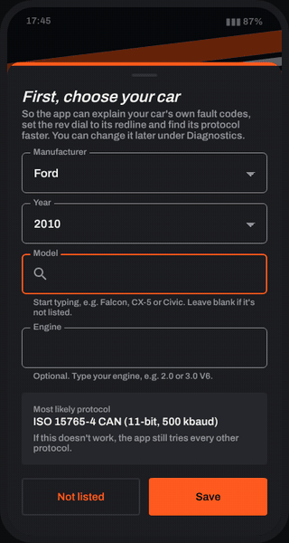
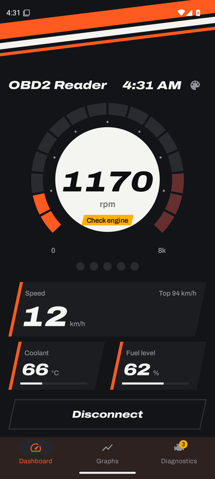
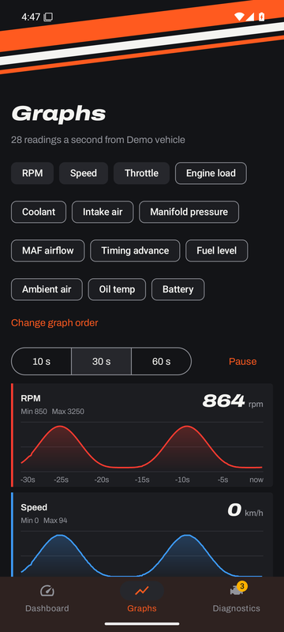
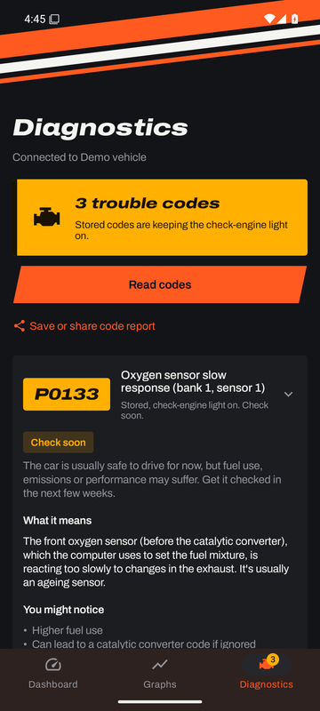
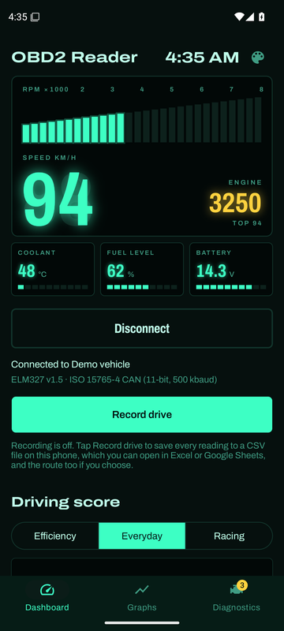
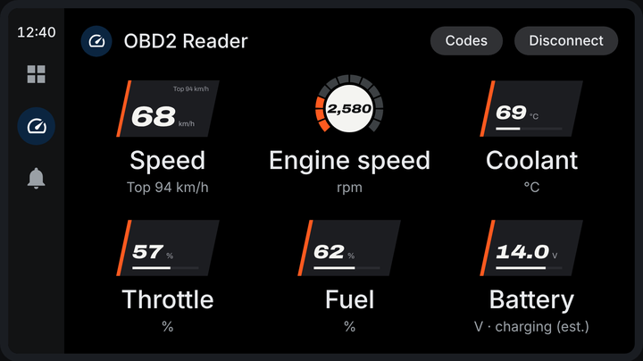
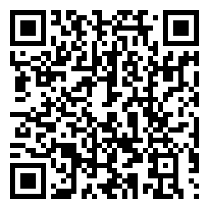
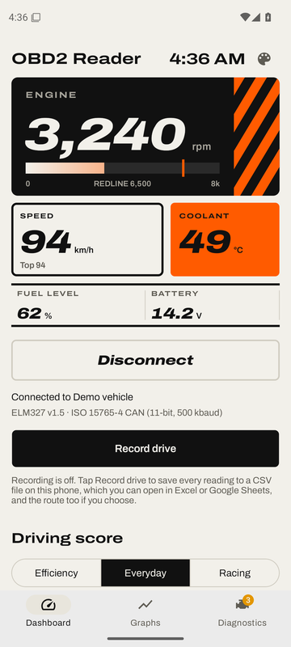
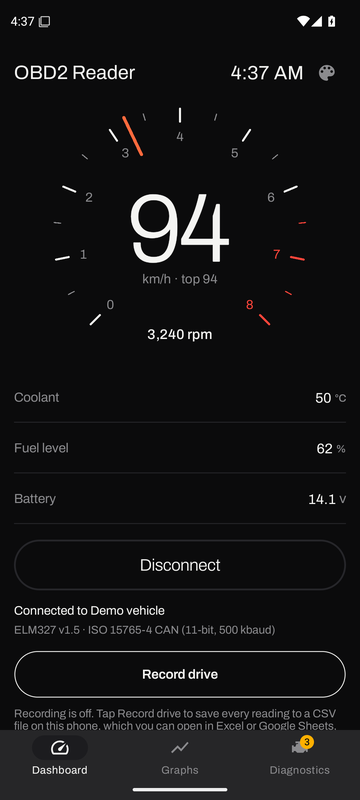

# OBD2 Reader

A free Android app for cheap ELM327 OBD2 adapters. It shows live engine data, explains your trouble codes in plain English and scores your driving. It also works on Android Auto. No account, no ads, and it never changes anything in your car.

**[Download the latest APK](https://github.com/CalmAussie/obd2-reader/releases/latest/download/OBD2Reader.apk)** · [Try the demo in your browser](https://raw.githack.com/CalmAussie/obd2-reader/main/preview/index.html) · [Changelog](CHANGELOG.md)

  

  
  
  
  

  

## Install

You only need the APK. Nothing else to install, and it works offline. It runs on Android 8 or newer.

1. On your phone, tap **[Download the latest APK](https://github.com/CalmAussie/obd2-reader/releases/latest/download/OBD2Reader.apk)**, or scan the QR code.
2. Open the file. If asked, allow **install unknown apps**, then tap **Install**.
3. If Play Protect warns you, tap **More details → Install anyway**. Every app from outside the Play Store gets this warning.

**Updates:** the app checks for a new version once a day and installs it when you tap **Update**. Your settings and drives are kept.

**Samsung phones:** Auto Blocker (**Settings → Security and privacy**) stops installs from outside the Galaxy Store and Play Store. Turn it off to install or update, then turn it back on if you like.

## Use it

1. Plug the adapter into the OBD2 port (under the dashboard, driver's side) and turn the ignition on.
2. Open the app and choose your car.
3. Tap **Connect** and pick your adapter.
   - **Bluetooth:** listed by name. If asked for a PIN, try `1234` or `0000`.
   - **Wi-Fi:** join the adapter's network first (usually `192.168.0.10`, port `35000`).
4. No adapter? Tap **Demo car**.

After the first time, it reconnects by itself. Help is also inside the app, under **Diagnostics → Help**.

## Features

**On the road**
- **Live data:** speed, revs, coolant, fuel, throttle, battery and more, gliding smoothly. Readings past their limit turn red.
- **13 styles:** from racing liveries to an 80s digital dash. Every style works in landscape too.
- **Android Auto:** your readings and trouble codes on the car's screen, drawn in your style.
- **Picture-in-picture (optional):** keep your readings in a small window over other apps.
- **Home-screen widget:** live readings while connected, the last drive and battery reading when not.
- **Alerts:** a hot engine, a battery not charging, or a new trouble code mid-drive. New codes notify quietly.

**After the drive**
- **Driving score:** out of 100 for Efficiency, Everyday or Racing, with a tip on what would help most.
- **Trip summary and history:** distance, times, top speed and your score's trend.
- **Same route as last time:** drive a recorded route again and see how you compare.
- **Record drives:** save them as CSV files for Excel or Google Sheets.
- **Video overlay:** turn a recorded drive into a gauge video for your dash-cam footage ([how](#video-overlay)).
- **Drive cards:** a picture of your drive for Shorts, TikTok, Reels or Instagram.
- **Performance timers:** 0–100 km/h, 80–120 km/h and the quarter mile (or 0–60 mph and 50–70 mph).

**Diagnostics**
- **Trouble codes explained:** about 2,860 codes, with what they mean, how urgent they are and what to check.
- **Freeze frame:** the engine's readings at the moment a code was stored.
- **Code report:** save or share all your codes with your mechanic.
- **Battery checks:** how far the battery dips when starting, and an optional overnight drain check.
- **Deeper checks:** readiness monitors, self-test results, and codes from ABS, airbags and other modules (on CAN cars).
- **VIN:** reads your car's VIN. You can enter the one on your plate if they differ.

## Styles

Tap the palette button on the Dashboard. The first seven are colourways; the last six have layouts of their own.

| Style | Look |
|---|---|
| Asphalt (default) | Orange and white stripes on dark grey |
| Endurance | Night-race navy and yellow |
| Kerb | Red and white kerb stripes |
| Pit lane | Light, in black and red. Best in sunlight |
| Drift | Hot pink and teal |
| Apex | Volt yellow on carbon black |
| British racing | Cream and gold on racing green |
| Race telemetry | Shift lights, big numbers and live traces |
| Digital cockpit | One big speed in a glowing ring |
| Cyberpunk | A neon heads-up display |
| Retro digital | An 80s digital dash in glowing teal |
| Rally stage | Paper white, black and orange. Easy to read in sun |
| Hairline | Fine lines on black, like a watch face |

  
  
  

## Compatibility

**Adapters**
| Type | Works? |
|---|---|
| Bluetooth ELM327 (v1.4 or newer, clones, STN-based) | Yes |
| Bluetooth LE ("iPhone-compatible", e.g. Veepeak OBDCheck BLE+) | Yes |
| Wi-Fi ELM327 | Yes |
| Maker-locked (ThinkDiag, BlueDriver and similar) | Only if they answer like an ELM327 |
| USB | No |

**Cars**
| Where | From |
|---|---|
| Australia | Petrol about 2006, diesel about 2007 |
| United States | 1996 |
| Europe | Petrol 2001, diesel 2004 |

The app tries all nine OBD2 protocols for you. Many cheap clones can't talk to 2000s Fords or pre-2008 GM, Chrysler, Dodge or Jeep cars; use a genuine ELM327 or STN adapter for those. Electric cars give few or no standard readings. iPhones aren't supported.

Cars only report some readings. Anything yours doesn't report shows **N/A**, never a guess. [Which cars get which codes](docs/CODE-SUPPORT.md) lists every model.

## Android Auto

Android Auto only shows Play Store apps until you allow others:

1. Open Android Auto's settings (search "Android Auto" in Settings).
2. Tap **Version** about 10 times to turn on developer mode.
3. Open the three-dot menu → **Developer settings** → turn on **Unknown sources**.
4. Reconnect to your car. OBD2 Reader is now in the app list.

## Video overlay

1. Start your camera, then tap **Record drive** in the app. The overlay's 0:00 is the moment you tap.
2. After the drive, go to **Graphs → Saved drives**, choose it and tap **Make a video overlay**.
3. Choose a green or black background, and 1080p or 720p.
4. In your editor, put the overlay above your footage. Key out the green (or use **Screen** blend for black) and line up 0:00.

Videos are saved to **Movies → OBD2 Reader**.

## Privacy and safety

- **Read-only:** the app never clears codes or changes anything in your car. Anything that isn't a read is blocked.
- **No account, no tracking:** nothing is sent to the developer. The only internet use is the update check, from GitHub.
- **Your location stays on your phone:** it's only saved inside a drive you choose to record with its route.

## Feedback

Found a problem or have an idea? Use **Diagnostics → Report a problem** or **Suggest an improvement** in the app, or go straight to the forms: [report a problem](https://github.com/CalmAussie/obd2-reader/issues/new?template=bug_report.yml) · [suggest an improvement](https://github.com/CalmAussie/obd2-reader/issues/new?template=feature_request.yml). You need a free GitHub account. Please leave out your VIN and number plate.

## For developers

- **Build:** every push to `main` runs the unit tests, builds a signed APK and publishes a release. To build locally, use Android Studio (JDK 17) or `gradle assembleRelease` with Gradle 8.7.
- **Release:** bump `obdVersion` in `gradle.properties` and add a [`CHANGELOG.md`](CHANGELOG.md) entry, which becomes the release notes.
- **Install test:** each release is installed on Android 10, 13, 15 and 16 emulators (17 experimental), run with the demo car and checked for crashes.
- **Preview:** [`preview/index.html`](preview/index.html) is a web mock-up of the app. Check changes in the real app too.
- **Signing:** the key lives in repository secrets (`OBD_KEYSTORE_BASE64`, `OBD_KEYSTORE_PASSWORD`, `OBD_KEY_ALIAS`, `OBD_KEY_PASSWORD`). Never commit a keystore.

Code lives under `app/src/main/java/com/obdreader/app/`: `obd/` (adapters, parsing, codes, car data), `session/` (the shared connection, recording, alerts), `ui/` (styles and dashboard views), `car/` (Android Auto) and `MainActivity.kt` (the three tabs).

## Licence

OBD2 Reader is open source under the [MIT licence](LICENSE).

- The [Archivo](https://fonts.google.com/specimen/Archivo) typeface is under the SIL Open Font License ([`licenses/Archivo-OFL.txt`](licenses/Archivo-OFL.txt)).
- Approximate top speeds come from [autoevolution.com](https://www.autoevolution.com) via the [automobile-models-and-specs](https://github.com/ilyasozkurt/automobile-models-and-specs) dataset.
- Trouble code names follow SAE J2012, cross-checked against [python-OBD](https://github.com/brendan-w/python-OBD), [AndrOBD](https://github.com/fr3ts0n/AndrOBD) and the [Wal33D DTC database](https://github.com/Wal33D/dtc-database). Ford definitions come from Ford's published *OBD System Operation Summary* documents.
