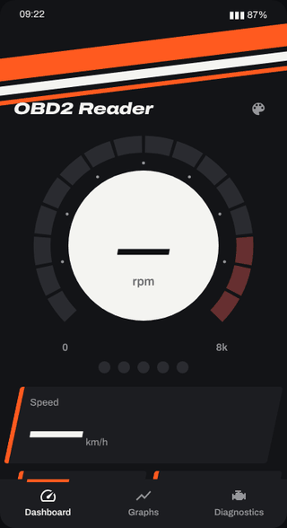
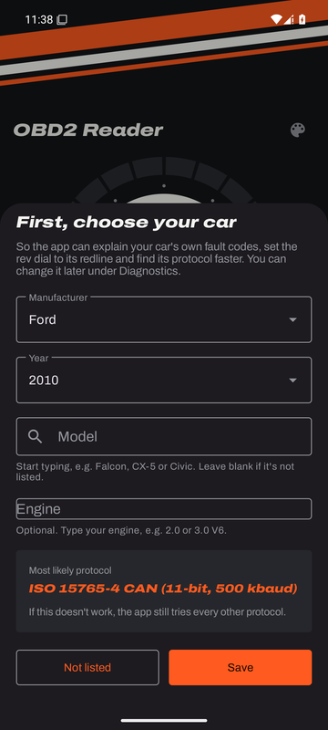
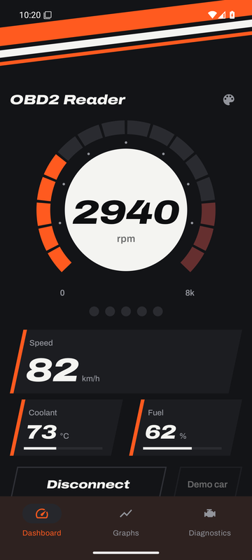
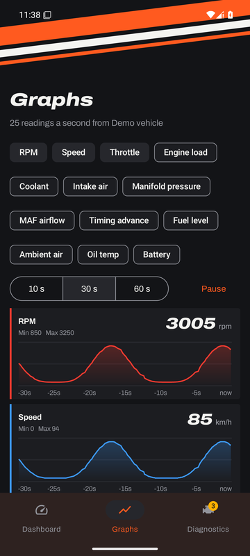
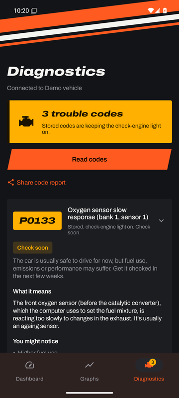
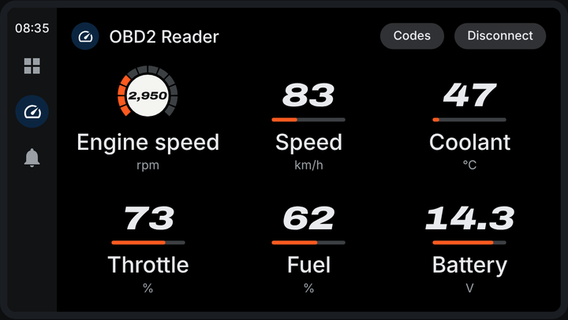
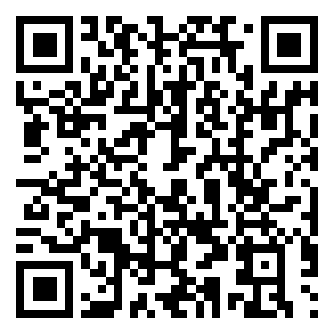

# OBD2 Reader

An Android app that reads live engine data and trouble codes from a cheap ELM327 OBD2 adapter, over Bluetooth or Wi-Fi. It also has an Android Auto screen.

**[Download the latest APK](https://github.com/CalmAussie/obd2-reader/releases/latest/download/OBD2Reader.apk)** · [All releases](https://github.com/CalmAussie/obd2-reader/releases) · [Changelog](CHANGELOG.md)

## What it looks like

  

**[Try the interactive demo in your browser](https://raw.githack.com/CalmAussie/obd2-reader/main/preview/index.html)**: tap **Demo car**, switch styles with the palette button, and open **Android Auto** at the top to see the car screen. It's a web mock-up of the app, so nothing needs installing.

The real app, version 1.4.2, running on Android 15 with the demo car:

  
  
  
  

  

## Install
All you need is the APK. There's no Play Store listing, account, sign-in or other app to install, and it works offline.

1. On your Android phone (Android 8 or newer), tap **[Download the latest APK](https://github.com/CalmAussie/obd2-reader/releases/latest/download/OBD2Reader.apk)**, or scan the QR code with the phone's camera.
2. Open the downloaded file. If asked, allow your browser or file app to **install unknown apps**, then tap **Install**.
3. If Google Play Protect warns about an unknown developer, tap **More details → Install anyway**. Every app from outside the Play Store gets this warning.
4. Open OBD2 Reader and choose your car (or **Not listed**). Then tap **Demo car** to try it straight away, or plug in an adapter and tap **Connect**.

To update, install a newer APK over the old one. Your settings are kept.

Every release is checked automatically: the published APK is downloaded, installed on fresh Android 8, 10, 13 and 15 phones (emulators), opened, run with the demo car and checked for crashes.

## Use it
1. Plug the adapter into the OBD2 port (under the dashboard, driver's side) and turn the ignition on.
2. Open the app, tap **Connect** and choose how your adapter connects:
   - **Bluetooth:** the app lists paired and nearby adapters by name, whichever kind of Bluetooth they use (Classic or LE). If yours needs pairing, Android asks for the PIN, usually `1234` or `0000`.
   - **Wi-Fi:** join the adapter's Wi-Fi network first. The usual address is `192.168.0.10`, port `35000`.
3. No adapter? Tap **Demo car** to try the app with a simulated car.
4. After the first time, the app reconnects by itself whenever you open it or turn the ignition on.

Help, including Android Auto setup, is also inside the app under **Diagnostics → Help**.

## What it does
- **Live data:** RPM, speed, coolant, fuel, throttle, engine load, intake air, manifold pressure, MAF, timing advance, ambient and oil temperature, and battery voltage. Readings past their limit turn red.
- **Top speed:** the highest speed of the current drive shows beside the speed, on the phone and in Android Auto.
- **Your car first:** the app asks for your car's make, year and model when you first open it, so manufacturer-specific trouble codes are explained for your brand, the rev dial uses your engine's redline, and your car's protocol is tried first. It then lists any readings that may not work on a car like yours, and why.
- **Driving score:** rates the current drive out of 100 for **Efficiency**, **Everyday** driving or **Racing** (track days), with a score for each habit and a tip for what would help most.
- **Graphs and drive logs:** live charts for up to four readings at once, fast multi-reading polling, and CSV recording of whole drives that you can share to Excel or Google Sheets. Drives are only recorded when you tap **Record drive**, and recordings are never included in backups.
- **Trouble codes, explained:** reads stored and pending codes and explains each one: what it means, how urgent it is, symptoms, common causes and what to check. Share the lot as a report for your mechanic.
- **Read-only:** the app never clears codes, turns off the check-engine light or changes anything in the car. Every command is checked before it's sent, and anything that isn't a read is blocked.
- **Reconnects by itself:** picks the adapter back up when you open the app, start Android Auto or turn the ignition back on.
- **Readable adapter log:** every message to and from the adapter is explained in plain English (for example "Engine RPM: 3,176 rpm" under the raw reply), with the latest trouble codes and their definitions pinned at the top. Share it as a text file when troubleshooting.
- **Vehicle ID:** reads the VIN and shows the make and model year.
- **Finds the right protocol:** tries every OBD2 protocol automatically. If your car won't connect, choose it under **Diagnostics → Your car** (69 makes from 2000 on) so the app tries that car's usual protocol first.
- **Background connection:** keeps working with the screen off, with a notification showing live RPM, speed and coolant.

## Compatibility

**Phones**
| | |
|---|---|
| Android | 8.0 (Oreo) or newer |
| Android Auto | Any car or head unit with Android Auto, wired or wireless, using the phone's Android Auto app |
| iPhone | Not supported (Android only) |

**Adapters**
| Type | Works with | Notes |
|---|---|---|
| Bluetooth Classic | ELM327 v1.4 and newer, and ELM327-compatible clones and STN-based adapters | Listed under Bluetooth; the app pairs it if needed |
| Bluetooth LE | "iPhone-compatible" ELM327 adapters, for example the Veepeak OBDCheck BLE+ | Listed under Bluetooth; no pairing needed |
| Wi-Fi | ELM327 Wi-Fi adapters | Default address `192.168.0.10`, port `35000`, changeable in the app |
| Not supported | Adapters locked to their maker's own app (for example BlueDriver), and USB adapters | |

**OBD2 protocols** (all nine an ELM327 supports, tried automatically)
| Protocol | Typical cars |
|---|---|
| ISO 15765-4 CAN (11-bit and 29-bit, 500 and 250 kbaud) | Almost every car from 2008 on |
| SAE J1850 PWM | 2000s Fords and Ford-based Mazdas |
| SAE J1850 VPW | Pre-2008 GM, Chrysler, Dodge and Jeep |
| ISO 9141-2 | 2000s Asian and European cars, including many Hondas, Mazdas and Toyotas |
| ISO 14230-4 KWP2000 (fast and 5-baud init) | 2000s Asian and European cars |

Many cheap ELM327 clones can't speak J1850 PWM or VPW. If you have a 2000s Ford or pre-2008 GM, Chrysler, Dodge or Jeep, use a genuine ELM327 or STN-based adapter.

**Cars**
| | |
|---|---|
| Australia | Petrol cars from about 2006, diesels from about 2007 (ADR 79). Many earlier imports also work |
| United States | 1996 on |
| Europe (EOBD) | Petrol from 2001, diesel from 2004 |
| Car catalogue | 69 makes from 2000 on, to help the app pick the right protocol: Japanese, American, European and Australian brands |
| Electric cars | Often limited or no standard engine readings. Teslas have no standard OBD2 port |
| Japanese-market imports | Some older ones use Japan's own standard and may not connect |

**What can be read:** standard (generic) OBD2 data only: live engine readings, emissions-related trouble codes (P0, P2 and generic U codes are explained in full), and the VIN. Maker-specific systems such as ABS, airbags, transmission data and service resets need the maker's own tools.

## Styles
Tap the palette icon on the Dashboard to choose a style. Your choice is saved. Every style also works in landscape: turn your phone sideways and the Dashboard puts the main dial on the left and the other readouts, Connect and status on the right. The first six are colourways of the livery dashboard; the last three each have a dashboard layout of their own.

| Style | Look |
|---|---|
| Asphalt (default) | Orange and white livery stripes on dark grey |
| Endurance | Night-race navy and yellow |
| Kerb | Red and white kerb stripes |
| Pit lane | A light style in black and red, for sunlight |
| Drift | Hot pink and teal |
| Apex | Volt yellow on carbon black, sharply raked |
| Race telemetry | A data-logger screen: shift lights, big numbers and live 30-second traces |
| Digital cockpit | One big speed in a glowing ring, on layered glass |
| Cyberpunk | A neon heads-up display: a climbing rev bar, split-colour speed digits and glowing readouts |

## Android Auto
The car screen shows live RPM, speed, coolant, throttle, fuel and battery, refreshing about five times a second with each number gliding to the next reading, and lists trouble codes. It uses your style's colours, but its background, fonts and layout are always Android Auto's own.

Android Auto only shows Play Store apps until you allow others. On your phone:
1. Open Android Auto's settings (search "Android Auto" in Settings).
2. Scroll to the bottom and tap **Version** about 10 times, then confirm to turn on developer mode.
3. Tap the three-dot menu, then **Developer settings**, and turn on **Unknown sources**.
4. Reconnect to your car. OBD2 Reader appears in Android Auto's app list.

## Good to know
- **Not every reading on every car:** cars only answer the readings they support, so some tiles may stay blank. The adapter log shows what the car supports.
- **Finding adapters on Android 11 and older** needs Location turned on while searching (an Android rule).

## For developers

**Building:** every push to `main` runs [`.github/workflows/build.yml`](.github/workflows/build.yml). It runs the unit tests, builds a signed APK and publishes it as a GitHub release. Pushes that only change Markdown files don't build a new release. To build locally, open the project in Android Studio (JDK 17) or run `gradle assembleRelease testDebugUnitTest` with Gradle 8.7 and the Android SDK.

**Preview:** [`preview/index.html`](preview/index.html) is an interactive mock-up of the app, with a demo car, every style, the Graphs and Diagnostics tabs and the Android Auto screen. Open it in a browser. It mirrors the app's layouts and logic but is a separate web page, so check changes in the app itself too.

**Install test:** [`.github/workflows/install-test.yml`](.github/workflows/install-test.yml) runs after every release. It installs the published APK on emulators (Android 8, 10, 13 and 15), starts the demo car, visits every tab and fails on any crash. Screenshots and results are pushed to the `install-test-reports` branch.

**QA:** push to the `qa` branch to run Android Lint, the unit tests and a build with compiler warnings, without publishing a release ([`.github/workflows/qa.yml`](.github/workflows/qa.yml)). The reports are committed back to `qa-reports/` on that branch.

**Releasing:** bump `obdVersion` in `gradle.properties` and add an entry at the top of [`CHANGELOG.md`](CHANGELOG.md). The release notes are taken from that entry.

**Signing:** updates only install over an older version when both are signed with the same key. The key lives in four repository secrets: `OBD_KEYSTORE_BASE64`, `OBD_KEYSTORE_PASSWORD`, `OBD_KEY_ALIAS` and `OBD_KEY_PASSWORD`. For local release builds, put the same values in an untracked `keystore.properties` file (`storeFile`, `storePassword`, `keyAlias`, `keyPassword`). Never commit the keystore.

**Code layout** (under `app/src/main/java/com/obdreader/app/`):

| Folder | What's in it |
|---|---|
| `obd/` | Adapter connections (Bluetooth, BLE, Wi-Fi, demo), the ELM327 client and parser, PIDs, protocols, trouble-code explanations, adapter-log translations, reconnect timing, the car catalogue and VIN decoder |
| `session/` | The shared connection used by the phone and the car, the background service, graph history, drive recording and exports |
| `ui/` | Styles and the custom views for each dashboard layout |
| `car/` | The Android Auto screens |
| `MainActivity.kt` | The Dashboard, Graphs and Diagnostics tabs, permissions and pickers |

## Licences
The app uses the [Archivo](https://fonts.google.com/specimen/Archivo) typeface under the SIL Open Font License ([`licenses/Archivo-OFL.txt`](licenses/Archivo-OFL.txt)).
